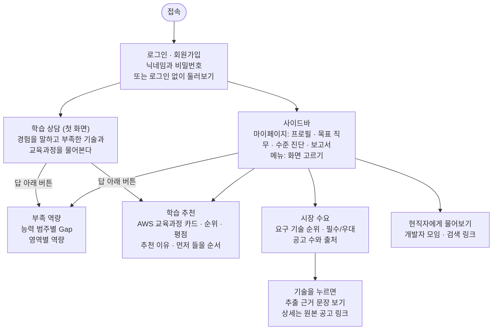
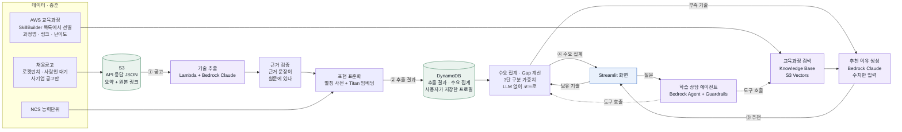

# 서비스 플로우

2026-11-12 회의, 2026-11-13 결정 반영. 그림은 Mermaid 텍스트라서 GitHub에서 이 파일을 열면 바로 그림으로 보입니다.
고치려면 파일 오른쪽 위 연필 아이콘을 누르고 아래 코드 블록의 글자를 바꾼 뒤 PR을 올립니다.
구조나 JSON 형식이 바뀌는 수정은 [`contracts/`](../contracts/README.md)와 같은 PR에서 함께 고칩니다.

## 1. 사용자 흐름

취업 준비생이 보유 기술을 고르고 추천을 받기까지의 화면 순서입니다.

- 처음 접속하면 로그인·회원가입 화면이 나오고, 들어오면 학습 상담이 첫 화면입니다. 나머지 화면은 사이드바 메뉴에서 엽니다(2026-11-20). 공고 직접 분석은 메뉴에서 뺐습니다.
- 비회원(손님)은 로그인 없이 현재 세션에서 모든 화면을 이용하고, 등록한 프로필은 비밀번호로 다시 열 수 있습니다.
- 발표의 세 질문과 화면의 대응: 어떤 데이터를 분석했나 → 시장 수요, 어떤 근거로 필요하다 판단했나 → 시장 수요의 근거 문장과 부족 역량, 왜 이 과정을 추천했나 → 학습 추천.
- 근거 문장은 추출 결과에서만 보여줍니다. 추천 화면에는 수요 수치와 추천 이유가 붙습니다(2026-11-12).
- 공고 상세 내용은 화면에 옮기지 않고 원본 공고 링크로 보냅니다. 링크는 시장 수요 화면의 근거 문장 옆에 붙입니다(2026-11-15). 링크가 없는 공고는 공고 id만 보입니다.

## 2. 시스템 구조

공고가 왼쪽에서 들어와 오른쪽 화면에서 추천으로 나옵니다. 화살표의 ①~④는 구간 사이를 오가는 JSON 형식 번호입니다.

| 색 | 뜻 |
| --- | --- |
| 보라 | AI가 하는 일 (Bedrock) |
| 초록 | 저장소 |
| 파랑 | 화면 |
| 색 없음 | 코드가 하는 일, 데이터 원천 |

구간별 담당과 이슈는 [WBS](wbs.md)에, JSON 형식은 [`contracts/`](../contracts/README.md)에 있습니다.

### 구조에서 지키는 것

1. **세기는 코드, 이해는 AI.** 보라색 칸만 Bedrock을 부릅니다. 빈도, 비율, Gap은 집계 코드가 계산하고 추천 이유는 그 숫자를 받아 쓰기만 합니다.
2. **근거 문장은 추출 단계에서만 씁니다.** 추출 직후 근거 문장이 공고 원문에 실제로 있는지 코드로 확인하고, 없으면 버리거나 "불확실"로 표시합니다.
3. **S3에는 API 응답 JSON을 저장합니다.** 요약 정보와 원본 공고 링크가 들어 있고, 근거 검증·프롬프트 재실행·정확도 측정에 같은 데이터를 씁니다. 공고 웹페이지 원문 전체는 저장하지 않습니다. 원본은 수정될 수 있어 상세는 링크로 보냅니다(2026-11-12).
4. **학습 상담 에이전트는 이미 만든 함수를 도구로 부르기만 합니다.** 수요 조회와 과정 검색 두 개이고, Guardrails가 주제 밖 질문을 막습니다.

### 아직 정해지지 않은 것

- 복합 Gap 정의
- 3단 구분(자격 요건, 주요 업무, 우대 사항)의 값 이름과 가중치 수치
- 역량 분류(8개 영역)를 데이터에 붙이는 방식
